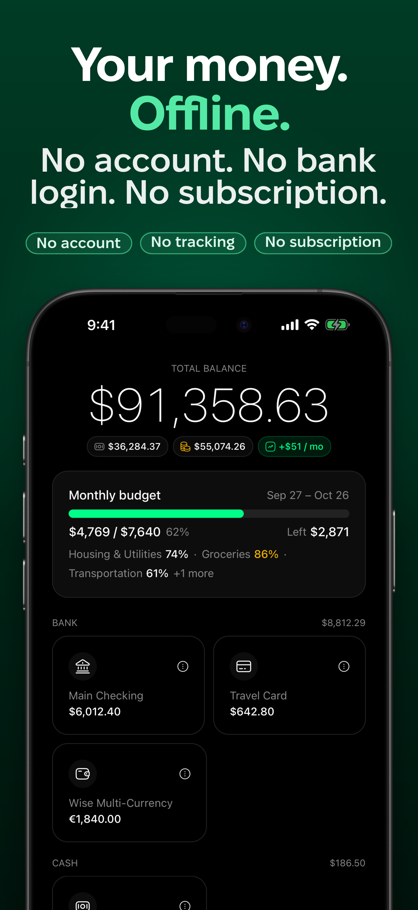
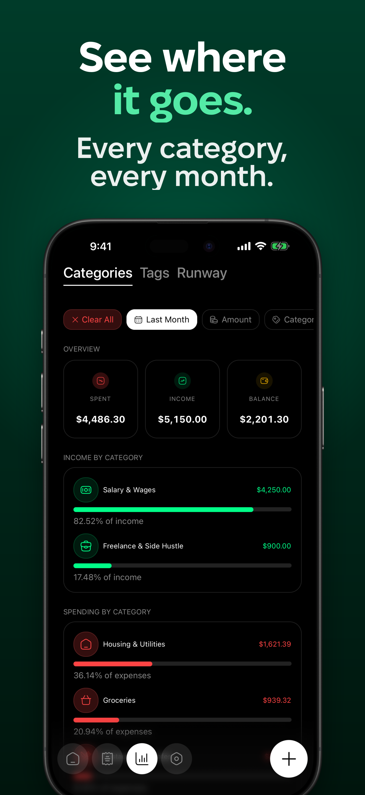
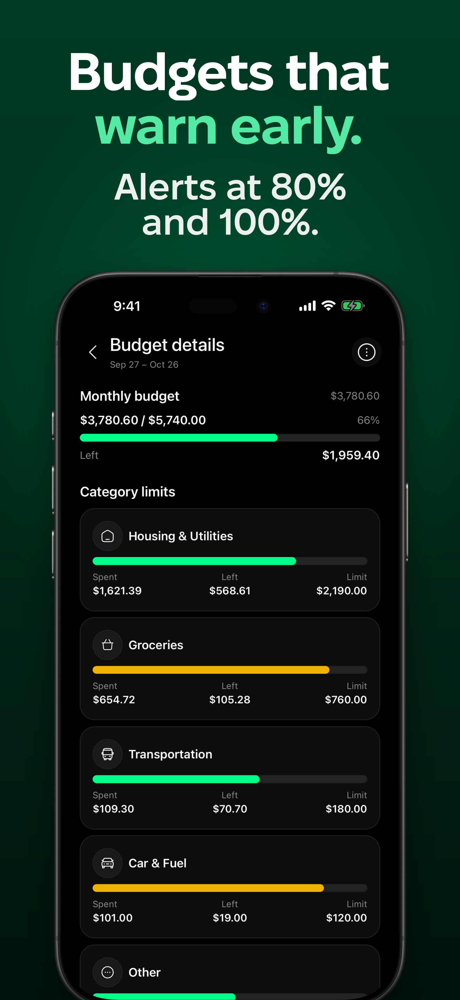
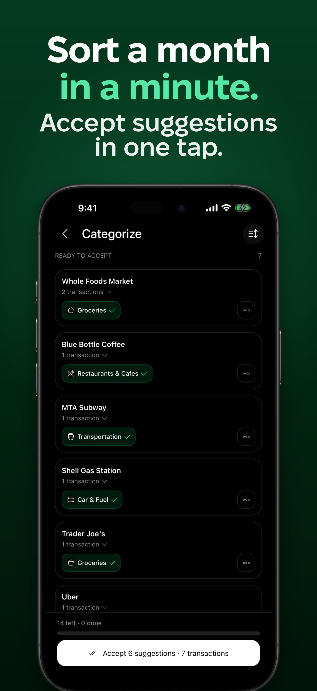

[](https://stand-with-ukraine.pp.ua)

<p align="center">
    <picture>
        <source media="(prefers-color-scheme: dark)" srcset="packages/landing/public/logo/white-on-black.svg">
        
    </picture>
</p>

<h1 align="center">Budgie</h1>

<p align="center">An offline-first expense tracker for iPhone and iPad. Your ledger lives on your device.</p>

<p align="center">
    <a href="LICENSE"></a>
    <a href="https://github.com/budgie-at/budgie/actions/workflows/main.yml"></a>
    
    <a href="https://www.budgie.at"></a>
</p>

Budgie tracks expenses, income, transfers, budgets and net worth across cash, bank, crypto, deposit and debt accounts. The local SQLite database is the source of truth: everyday use needs no account, no server and no connection. Bank sync, exchange-rate updates and AI are optional extras that run only when you turn them on, and the AI runs on the device.

<table align="center">
    <tr>
        <td></td>
        <td></td>
        <td></td>
        <td></td>
    </tr>
</table>

Screenshots show fixture data.

## Features

**Tracking**

- Expenses, income and transfers; refunds, split purchases and receipt scanning (the camera reads receipts on the device).
- Account types: bank, cash, crypto, stocks, savings, deposits and debts (lent, borrowed and installment plans), with multi-currency balances and net worth in a base currency.
- Categories and tags you define, plus automatic categories from merchant category codes.
- Spending analytics, date filters, and a runway estimate.

**Planning**

- Monthly budgets with category limits, funds and alerts as you approach a limit.
- Recurring charge detection and a calendar of upcoming charges.
- Rules that categorize, tag and convert transactions automatically, and an inbox for uncategorized spending.

**Getting data in and out**

- Bank sync with Monobank, Binance and Enable Banking (European banks, with your own Enable Banking key); statement import from PrivatBank exports and Erste PDFs; operations import for Inzhur fund accounts.
- CSV import with column mapping, CSV export, and database backups.

**On-device AI (optional, downloaded on demand)**

- Category and tag suggestions from an embedding model and a small language model, and voice entry with Whisper speech recognition. All three run locally through `llama.rn`.

**On iOS**

- Home Screen widgets (budget, net worth, quick add), Siri and Shortcuts through App Intents, Apple Pay capture, and a share extension for receipts.
- iCloud sync through CloudKit and household sharing of accounts.
- App lock with a PIN and biometrics, and screenshot protection.
- Five languages: English, German, Spanish, French and Ukrainian.

**Platforms.** iOS and iPadOS are the supported platforms: releases are built and published for iOS, and the end-to-end suite runs on iOS simulators. The Expo project also carries Android configuration (`pnpm android`, a package id and Play Store metadata), but the production release pipeline has Android publishing switched off.

## Privacy and data

- **Storage.** Transactions, accounts and settings are stored in a SQLite database on the device. Setting a PIN encrypts the database with SQLCipher, and backups keep that encryption.
- **Network use.** Budgie has no server of its own and ships no analytics SDK. The app contacts:
    - exchange-rate and price APIs (exchangerate-api.com, CoinGecko, Frankfurter) to value balances in your base currency;
    - your bank providers (Monobank, Binance, Enable Banking), only for connections you set up; the Enable Banking key is kept in the device's secure storage;
    - Hugging Face, to download the AI models once, after you enable AI;
    - Expo's update service, for over-the-air JavaScript updates in release builds;
    - iCloud, only if you enable sync, backup or household sharing.
- **AI.** Embeddings, suggestions and speech recognition run on the device after the models are downloaded. Receipts are read on the device.

## Tech stack

| Area | Technology |
| --- | --- |
| App | Expo 58, React Native 0.88, React 19.3 with React Compiler, Expo Router 58 |
| Data | SQLite through `@op-engineering/op-sqlite` (SQLCipher, sqlite-vec, FTS5) and Drizzle ORM 1.0 RC |
| Logic | [Effect](https://effect.website) 4: services, layers, typed errors, atoms for live queries |
| Styling and UI | Uniwind 1.13 (Tailwind CSS 4 for React Native), Reanimated 4, LegendList |
| i18n | Lingui 6.12 |
| On-device AI | `llama.rn` (embeddings, language model, Whisper) |
| Landing site | Next.js 16, React 19, Tailwind CSS 4 |
| Tooling | pnpm 12, Turborepo, Lerna, TypeScript 6 API with `tsrs` and `@typescript/native`, Oxlint with Effect rules, Oxfmt, Knip, jscpd |
| Tests | Vitest and `@effect/vitest`; end-to-end tests on iOS simulators |

## Repository layout

```
packages/
  app/             Expo app (feature modules, screens, native modules for iCloud, receipts and background sync)
  contracts/       Shared schemas, entities, repositories and the database port
  ledger/          Transactions, transfers, imports and account balances
  budget/          Budget domain logic
  market/          Exchange rates, market data and base-currency valuation
  recurring/       Recurring charge detection and calendar projection
  rules/           Rules engine: matching, application, transfer conversion
  categorization/  Embeddings, category and tag suggestions, categorize inbox
  ai/              AI services: suggestions, voice extraction, chat invoker
  import-export/   CSV import and export
  consolidation/   Transaction consolidation
  sync/            Bank integrations
  cloud-sync/      iCloud record mapping, sync engine and household sharing
  amount-input/    Auto-fitting amount input and display components
  landing/         Next.js marketing site (budgie.at)
tests/             Integration suites (sync, budget, consolidation) and the shared test kit
e2e/               End-to-end suite for the iOS app
docs/              Engineering notes: i18n, component composition, toolchain, CloudKit runbook
```

## Getting started

Requirements: Node.js 22.22.2 or newer and pnpm 12.16.1 (the `packageManager` field; `corepack enable` picks it up). Running the app needs a Mac with Xcode, because the app uses native modules and runs as an Expo dev client rather than in Expo Go.

```bash
pnpm install
pnpm build
```

Run the app in a development build on the iOS simulator (this variant builds with on-device AI disabled):

```bash
cd packages/app
pnpm ios
```

Start the Metro dev server for an installed dev client:

```bash
cd packages/app
pnpm start
```

Run the marketing site:

```bash
pnpm --filter @budgie-at/landing start
```

## Development

Run these before committing, in this order:

```bash
pnpm format && pnpm ts && pnpm lint && pnpm deadcode && pnpm cpd
```

- `pnpm test` runs the Turborepo `test` task. Domain packages keep suites in `packages/<name>/test/`, the app has a small node suite in `packages/app/test/`, and cross-package scenarios live in `tests/sync-tests`, `tests/budget-tests` and `tests/consolidation-tests`. There are no component tests.
- End-to-end tests live in `e2e/` and run against an E2E build of the app on iOS simulators. See [the E2E runbook](tests/app-tests/E2E-RUNBOOK.md).
- After changing user-facing text, run `pnpm i18n:sync` and commit the `.po` and `.ts` catalogs. See [docs/i18n.md](docs/i18n.md).
- Pull requests do not compile native code when a prebuilt base binary exists for their native key. See [AGENTS.md](AGENTS.md) for the CI model.

## Contributing

- Use [Conventional Commits](https://www.conventionalcommits.org) for commit messages and pull request titles: `type(scope): description`. Allowed scopes are `app`, `contracts`, `ai`, `landing`, `sync`, `cloud-sync`, `budget`, `market`, `ledger`, `recurring`, `rules`, `categorization`, `import-export`, `consolidation` and `amount-input`. Omit the scope for repo-wide changes.
- [AGENTS.md](AGENTS.md) holds the full coding rules; `CLAUDE.md` is a symlink to it.
- Work is tracked in GitHub issues, labelled by `status:*`, `kind:*`, `priority:*`, `needs:*`, `agent:*` and `area:*`.
- Report security issues privately through [GitHub security advisories](https://github.com/budgie-at/budgie/security/advisories/new) rather than a public issue. See [SECURITY.md](SECURITY.md).

## License

Budgie is released under the [O'SAASY License](LICENSE) (see [osaasy.dev](https://osaasy.dev)): you may use, modify and distribute it, but you may not offer it to third parties as a hosted or SaaS product that competes with the original licensor.
